# 🌸 SheBuilds — A Secure Women's Business & Freelance Marketplace

<p align="center">
  
</p>

<p align="center">
  <strong>Empowering women entrepreneurs, freelancers, and home-based businesses to showcase products, deliver services, and manage client inquiries through a hardened, role-aware, full-stack platform.</strong>
</p>

<p align="center">
  <a href="https://she-builds-flame.vercel.app/"></a>
  <a href="https://github.com/rdya-code/SheBuilds"></a>
  
  
  
</p>

---

## 📑 Table of Contents
- [✨ Key Platform Features](#-key-platform-features)
- [🖼️ Visual Interface Showcase](#️-visual-interface-showcase)
- [👥 Group Members & Responsibilities](#-group-members--responsibilities)
- [🚀 Semester Activities Roadmap (Phases 1–6)](#-semester-activities-roadmap-phases-16)
- [🔐 Demo Accounts & Role Permissions](#-demo-accounts--role-permissions)
- [🏗️ System Architecture & Data Flow](#️-system-architecture--data-flow)
- [📡 Complete Backend API Specification](#-complete-backend-api-specification)
- [🛡️ Security Hardening & Defensive Engineering](#️-security-hardening--defensive-engineering)
- [💻 Getting Started Locally](#-getting-started-locally)
- [🧪 Testing & Verification Evidence](#-testing--verification-evidence)

---

## ✨ Key Platform Features

- 🛡️ **Role-Based Access Control (RBAC):** Strict separation between **Seller** and **Customer** roles on both React client routes and Express/SQLite server endpoints.
- 🔑 **Cryptographic Authentication (JWT + Bcrypt):** Passwords stored exclusively as `bcrypt` hashes; protected routes guarded by signed `jsonwebtoken` (JWT Bearer) tokens.
- 🔒 **Real-Time Password Strength Evaluation (Phase 5):** Interactive 6-point evaluation metric with live color gauge, status badges, and an automated requirements checklist.
- 🛍️ **Core Marketplace (Radia Shahzad — Module 1):** Validated product and freelance service creation, dynamic category filtering, instant price boundary checks, and full database persistence.
- 📬 **Inquiries & Tracking Portal (Hareem Hamid — Module 2):** Secure communication between clients and creators with auto-generated reference tracking (`INQ-XXX`), status lifecycle management, and ownership isolation.
- 👁️ **Privacy-Aware Data Display:** Seller contact numbers are masked for clients (`+92 300 *******`) and only exposed in full to authenticated account owners.
- 🧱 **Component Failure Containment:** Dedicated React `ErrorBoundary` wraps critical views so runtime issues never crash the entire application.

---

## 🖼️ Visual Interface Showcase

<div align="center">

### 1. Landing Page & Public Marketplace
| Home / Hero Portal | Core Marketplace Grid |
|:---:|:---:|
| 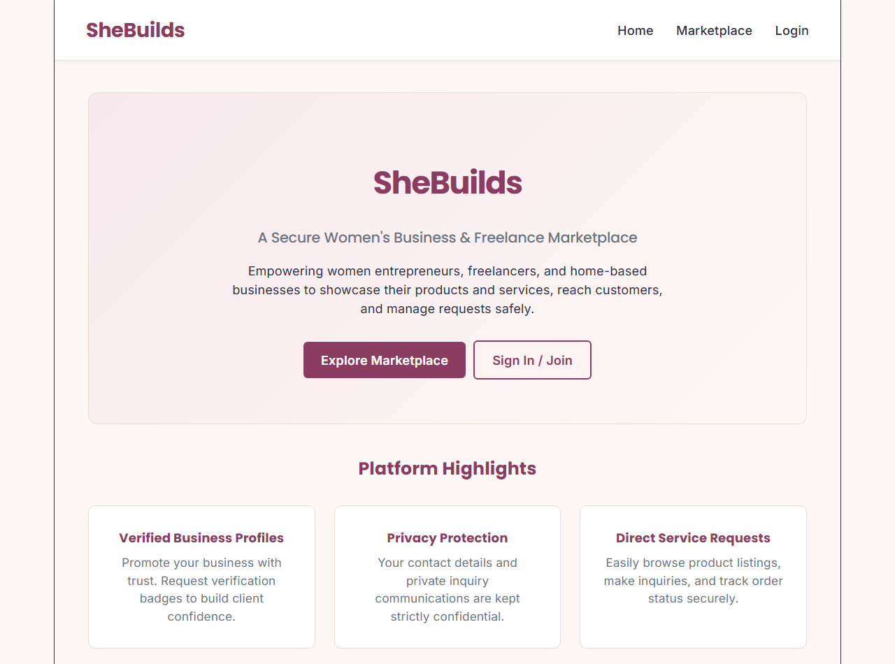<br><em>Platform mission, value cards & primary actions</em> | 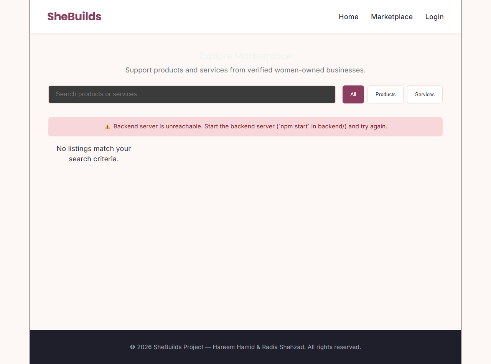<br><em>Dynamic search, category filters & item inquiries</em> |

<br>

### 2. Authentication & Phase 5 Password Strength Evaluation
| Login & Real-Time Strength Meter | Registration & Requirement Checklist |
|:---:|:---:|
| 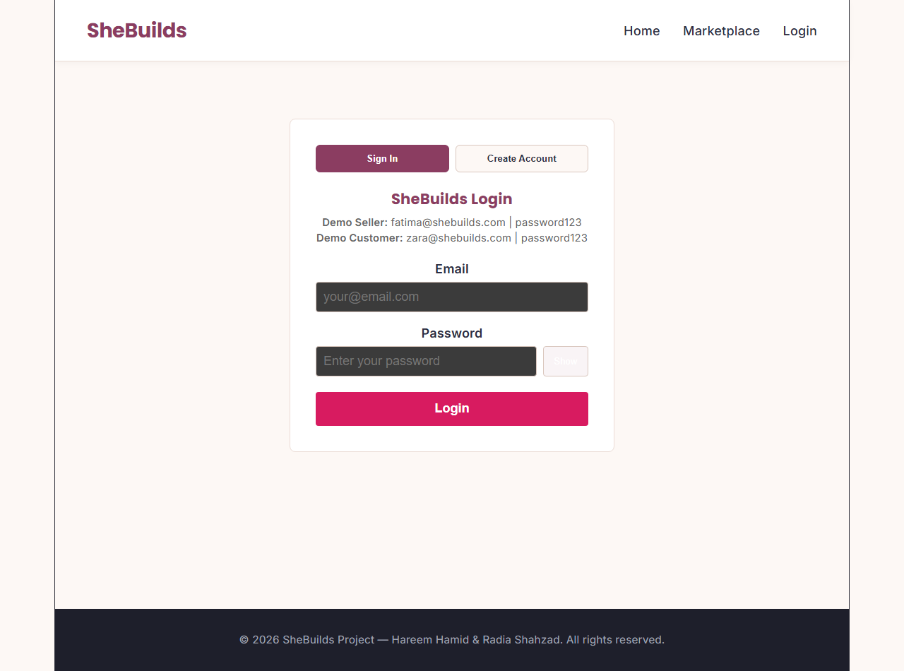<br><em>Password score (0–6), color badges & guidance messages</em> | <br><em>Live evaluation against length, casing, numbers & symbols</em> |

<br>

### 3. Role-Specific Dashboards
| Seller Dashboard & Summary | Customer Portal & Masked Contacts |
|:---:|:---:|
| 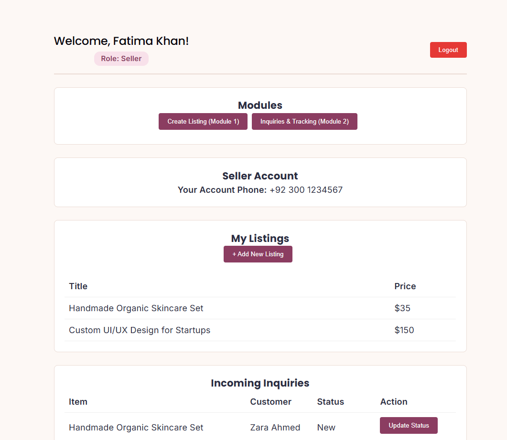<br><em>Active listings summary, incoming requests & management</em> | 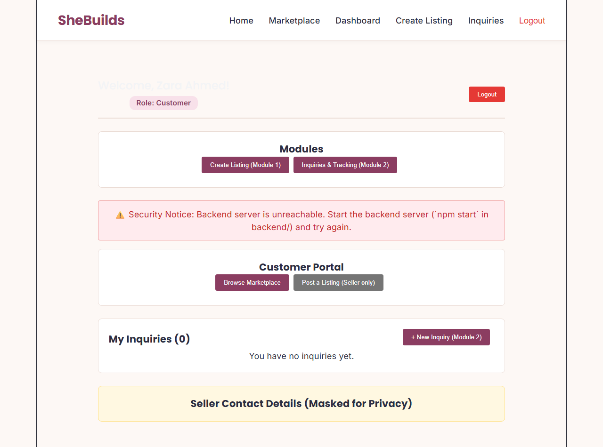<br><em>My inquiries status tracking & privacy-masked seller phone numbers</em> |

<br>

### 4. Functional Modules (Parallel Development)
| Module 1: Create Listing (Radia Shahzad) | Module 2: Inquiries & Tracking (Hareem Hamid) |
|:---:|:---:|
| 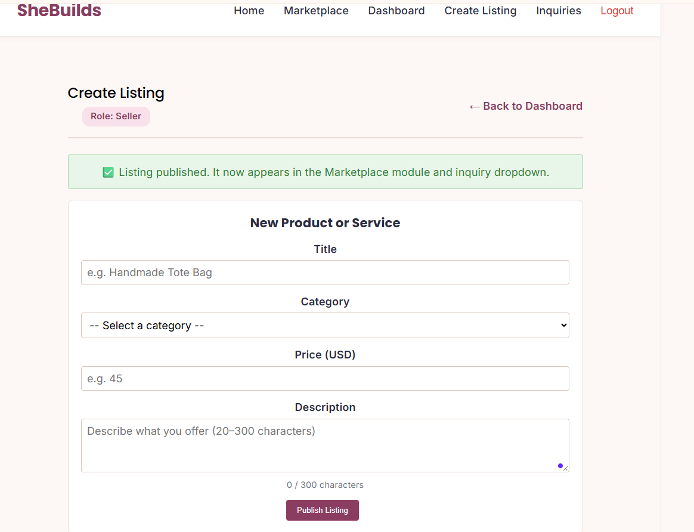<br><em>Seller-only listing publication with boundary validation</em> | 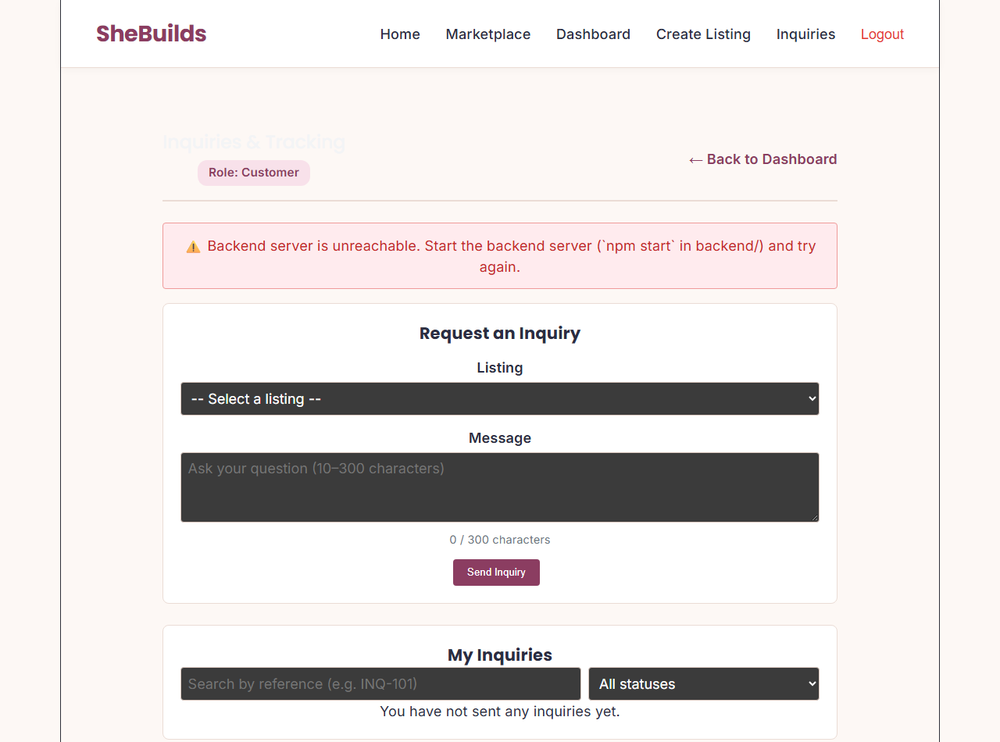<br><em>Customer inquiry creation with auto-assigned INQ-XXX references</em> |

<br>

### 5. Defensive Validation & Failure Handling
| Form Boundary Validation Errors | Architecture Component Dependency Graph |
|:---:|:---:|
| 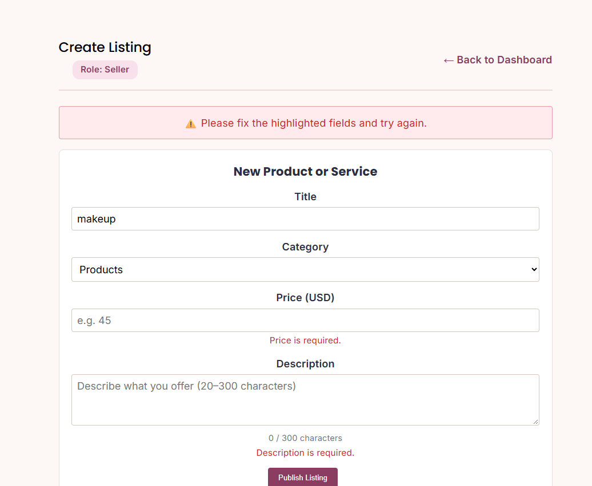<br><em>Field-level inline errors & live character limit counter</em> | 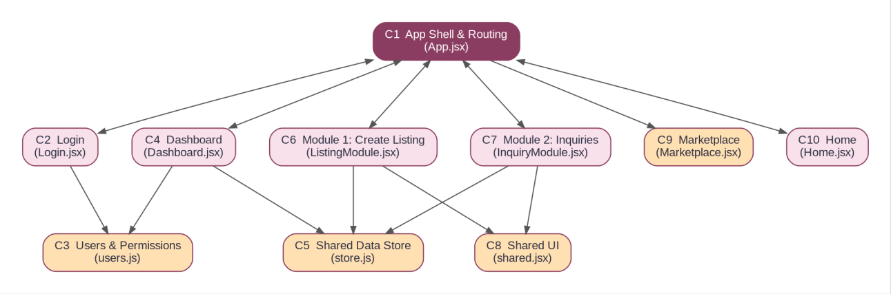<br><em>Activity 4 dependency mapping and single-point-of-failure analysis</em> |

</div>

---

## 👥 Group Members & Responsibilities

| Contributor | Primary Module | Core Responsibilities |
|---|---|---|
| **Hareem Hamid**<br>(`Hareem986`) | **Module 2 — Inquiries & Tracking** | • Express & SQLite Backend Architecture (`backend/db.js`, `schema.sql`)<br>• JWT Authentication & Verification Middleware (`backend/middleware/auth.js`)<br>• Inquiries API endpoints (`backend/routes/inquiries.js`)<br>• Customer tracking interface & status filter (`InquiryModule.jsx`)<br>• Server-side phone number privacy masking (`maskPhone`) |
| **Radia Shahzad**<br>(`rdya-code`) | **Module 1 — Create Listing** | • Initial UI/UX styling & platform design tokens (`App.css`)<br>• Public marketplace catalog & category filter (`Marketplace.jsx`)<br>• Create Listing module & input boundary checks (`ListingModule.jsx`)<br>• Listings API endpoints & ownership checks (`backend/routes/listings.js`)<br>• Seller management dashboard views (`Dashboard.jsx`) |

---

## 🚀 Semester Activities Roadmap (Phases 1–6)

<details open>
<summary><b>Click to expand/collapse semester milestone status</b></summary>
<br>

| Phase / Activity | Objective & Description | Key Deliverables | Status |
|:---:|---|---|:---:|
| **Activity 1** | **Project Inception & Frontend Prototype** | Home page, brand identity, navigation shell, initial Marketplace layout | ✅ **Completed** |
| **Activity 2** | **Role-Based Functional Prototype** | Role separation (Seller vs Customer), demo login, Dashboard, phone masking | ✅ **Completed** |
| **Activity 3** | **Parallel Module Development & Integration** | Module 1 (Listings) & Module 2 (Inquiries), shared data store, field validation | ✅ **Completed** |
| **Activity 4** | **Dependency Mapping & Failure Analysis** | Component failure matrix, 10-node dependency graph, React `ErrorBoundary` | ✅ **Completed** |
| **Activity 5** | **Basic Secure Coding Implementation** | `password_strength_helper.js` integration, XSS sanitization, 2MB file bounds | ✅ **Completed** |
| **Activity 6** | **Full Backend Development & DB Integration** | Node/Express API, SQLite database, bcrypt hashing, JWT tokens, RBAC endpoints | ✅ **Completed** |

</details>

---

## 🔐 Demo Accounts & Role Permissions

All accounts are seeded automatically into `backend/shebuilds.db` upon initial startup. Passwords are saved strictly as bcrypt hashes.

| Account Name | Role | Email | Password | Permissions & Scope |
|---|:---:|---|---|---|
| **Fatima Khan** | `Seller` | `fatima@shebuilds.com` | `password123` | Publish listings, view own listings, view incoming inquiries, update inquiry status |
| **Ayesha Noor** | `Seller` | `ayesha@shebuilds.com` | `password123` | Second verified seller to demonstrate data isolation and ownership enforcement |
| **Zara Ahmed** | `Customer` | `zara@shebuilds.com` | `password123` | Browse marketplace, submit inquiries, view personal inquiry history & status |

<details>
<summary><b>View Role Permission Matrix</b></summary>
<br>

```json
{
  "Seller": [
    "add_listing",
    "view_my_listings",
    "view_inquiries",
    "update_inquiry_status"
  ],
  "Customer": [
    "browse_marketplace",
    "view_my_inquiries"
  ]
}
```
</details>

---

## 🏗️ System Architecture & Data Flow

### 1. Authentication & JWT Authorization Pipeline
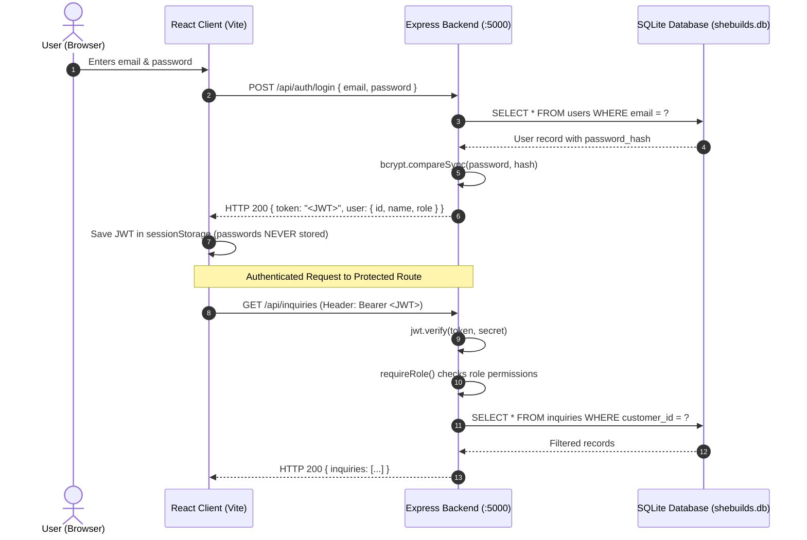

### 2. Multi-Role Inquiry & Service Request Lifecycle
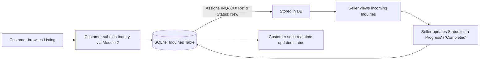

---

## 📡 Complete Backend API Specification

<details open>
<summary><b>Authentication Endpoints (/api/auth)</b></summary>
<br>

| Method | Endpoint | Access | Body / Params | Expected Response |
|---|---|:---:|---|---|
| `POST` | `/api/auth/login` | Public | `{ email, password }` | `200 OK` + signed JWT token & user profile |
| `POST` | `/api/auth/register` | Public | `{ name, email, phone, role, password }` | `201 Created` + token & new user profile |
| `GET` | `/api/auth/me` | JWT | None (Bearer header) | `200 OK` + current user profile |
| `GET` | `/api/auth/sellers` | JWT | None (Bearer header) | `200 OK` + seller list with server-masked phone numbers |

</details>

<details open>
<summary><b>Module 1 — Listings Endpoints (/api/listings) — Radia Shahzad</b></summary>
<br>

| Method | Endpoint | Access | Body / Params | Expected Response |
|---|---|:---:|---|---|
| `GET` | `/api/listings` | Public | `?category=Products&search=skincare` | `200 OK` + array of active marketplace listings |
| `GET` | `/api/listings/mine` | Seller | None (Bearer header) | `200 OK` + listings published by authenticated seller |
| `POST` | `/api/listings` | Seller | `{ title, category, price, description }` | `201 Created` + newly saved listing record |
| `DELETE` | `/api/listings/:id` | Seller | URL param `:id` | `200 OK` (enforces strict ownership check) |

</details>

<details open>
<summary><b>Module 2 — Inquiries & Tracking Endpoints (/api/inquiries) — Hareem Hamid</b></summary>
<br>

| Method | Endpoint | Access | Body / Params | Expected Response |
|---|---|:---:|---|---|
| `GET` | `/api/inquiries` | JWT | `?ref=INQ-101&status=New` | `200 OK` + inquiries filtered by role (`customer_id` or `seller_id`) |
| `POST` | `/api/inquiries` | Customer | `{ listingId, message }` | `201 Created` + auto-generated reference number (`INQ-XXX`) |
| `PATCH` | `/api/inquiries/:ref/status` | Seller | `{ status: "In Progress" }` | `200 OK` + updated inquiry (enforces seller ownership) |

</details>

---

## 🛡️ Security Hardening & Defensive Engineering

```
┌────────────────────────────────────────────────────────────────────────┐
│                   SheBuilds Defense-in-Depth Model                     │
├────────────────────────────────────────────────────────────────────────┤
│ 1. User Interface: Live bounds, password strength meter, noValidate   │
│ 2. Network Layer: Vite API proxy, CORS restrictions, security headers │
│ 3. Authentication: Cryptographic JWT verification, 8h token expiry     │
│ 4. Authorization: Role-Based Access Control (RBAC) & Ownership checks  │
│ 5. Data Access: Parameterized SQLite queries (Zero SQL injection)     │
│ 6. Storage Hygiene: Bcrypt hashing (10 rounds), zero plaintext storage │
│ 7. Fault Isolation: React ErrorBoundary prevents cascading crashes    │
└────────────────────────────────────────────────────────────────────────┘
```

1. **SQL Injection Prevention:** Every query in `backend/` uses prepared statements with parameterized `?` variables via `node:sqlite`. No string concatenation is used in queries.
2. **Server-Side Input Validation:** All endpoints validate data types, non-empty trimmed strings, character length limits, and enum values independently of the client.
3. **Sensitive Information Protection:** Plaintext passwords are purged from memory after hashing; browser storage (`sessionStorage`) stores only the signed JWT and safe display fields (`id`, `name`, `email`, `role`).
4. **Data Isolation:** A customer cannot view inquiries belonging to another customer; a seller cannot modify inquiries or delete listings owned by another seller.
5. **Sanitized Error Responses:** Backend catches internal exceptions cleanly and returns human-friendly JSON error messages without leaking stack traces or database structure.

---

## 💻 Getting Started Locally

### Prerequisites
- **Node.js:** `v22.5.0` or higher (tested with Node `v24.x`, utilizes built-in `node:sqlite`)
- **Git**

### 1. Clone the Repository
```bash
git clone https://github.com/rdya-code/SheBuilds.git
cd SheBuilds/SheBuilds
```

### 2. Start the Backend API Server
```bash
cd backend
npm install
npm start
```
> The backend server starts on **`http://localhost:5000`**. On first boot, it auto-creates `shebuilds.db` and populates the seed data.

### 3. Start the Frontend React Client
In a new terminal window:
```bash
npm install
npm run dev
```
> The Vite development server launches at **`http://localhost:5173`** with an automated proxy route forwarding all `/api/*` requests to the backend.

---

## 🧪 Testing & Verification Evidence

All functional modules and security controls were validated with automated suites and verified test cases:

```bash
# Run ESLint across all frontend and backend source files
npm run lint

# Compile production Vite build
npm run build
```

<details>
<summary><b>View Automated Backend Test Results (18 Passed)</b></summary>
<br>

| # | Test Scenario | Expected Outcome | Result |
|:---:|---|---|:---:|
| 1 | Health Check (`GET /api/health`) | HTTP 200, database connected | **PASSED** |
| 2 | Public Listings Retrieval (`GET /api/listings`) | HTTP 200, returns active listings | **PASSED** |
| 3 | Missing Bearer Token on Protected Route | HTTP 401 Unauthorized | **PASSED** |
| 4 | Malformed / Tampered Token | HTTP 401 Access Denied | **PASSED** |
| 5 | SQL Injection Payload in Login Input | HTTP 400 Format Rejected | **PASSED** |
| 6 | Valid Seller Authentication (Fatima) | HTTP 200, signed JWT returned | **PASSED** |
| 7 | Valid Customer Authentication (Zara) | HTTP 200, signed JWT returned | **PASSED** |
| 8 | Customer attempts Seller operation | HTTP 403 Forbidden | **PASSED** |
| 9 | Seller attempts Customer inquiry submission | HTTP 403 Forbidden | **PASSED** |
| 10 | Listing Input Bounds Validation (min/max limits) | HTTP 400 Field Errors returned | **PASSED** |
| 11 | Seller creates valid Listing in SQLite | HTTP 201 Created & saved | **PASSED** |
| 12 | Customer submits inquiry on new Listing | HTTP 201 Assigned INQ-104 | **PASSED** |
| 13 | Seller B attempts status change on Seller A item | HTTP 403 Ownership Denied | **PASSED** |
| 14 | Legitimate Seller updates Inquiry Status | HTTP 200 Status: In Progress | **PASSED** |
| 15 | Customer views real-time updated status | HTTP 200 Status reflected | **PASSED** |
| 16 | Prevent deletion of Listing with linked inquiry | HTTP 409 Conflict | **PASSED** |
| 17 | Server-side Phone Masking for Clients | Phone ends with `*******` | **PASSED** |
| 18 | New User Registration & Immediate Profile Fetch | HTTP 201 Created & Verified | **PASSED** |

</details>

---

<p align="center">
  <strong>SheBuilds — Academic Semester Project for Secure Software Development (SSD)</strong><br>
  Developed by <strong>Hareem Hamid</strong> (23F-3099) & <strong>Radia Shahzad</strong><br>
  FAST National University of Computer & Emerging Sciences
</p>
